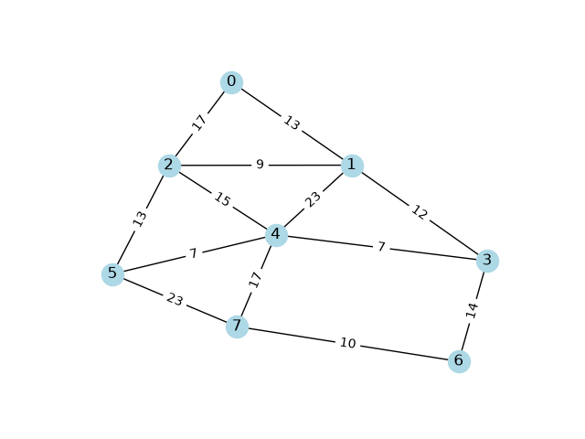
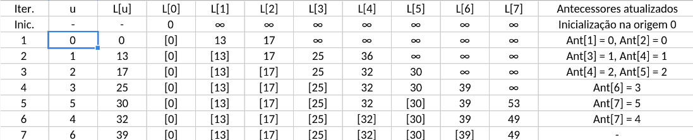
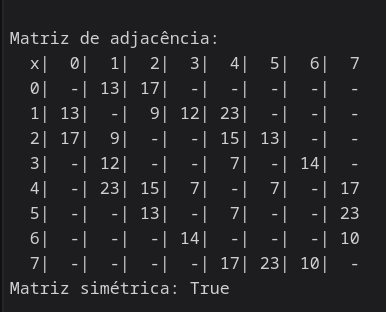
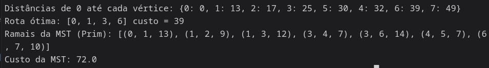

# Dev LOOOOG

Comecei lendo o pdf, pegando meu RA, e fazendo uma matrix de paridade com os pesos já calculados (arduosamente), porque não ficou muito claro como fazer, mas fiz da melhor forma que pude, o que acabou consumindo um bom tempo aí. 
Aliás, meu RA é: A2024.1A.0123 ; logo, usei 410123 . Fiz alguns mas decidi já passar para código que seria melhor

Pegando o exemplo da intro do networkx, inicializei com:

```
import networkx as nx
G = nx.Graph()
```
E adicionei os vértices e arestas seguindo esse modelo da docs do networkx, só como template:

```
G.add_nodes_from([2, 3])
G.add_weighted_edges_from([(0, 1, 3.0), (1, 2, 7.5)])
```
Depois disso, parti para transformar meu RA em pesos usando as formulas dadas, colocando cada dígito do RA como uma variável. Fiz o venv, dei pip install, e rodei dando um print no primeiro só para testar. Depois copiei todas as formulas da tabela, e só dei um replace all do "mod" para "%"

Depois de terminar dei um print em todos os pesos das arestas e deu o seguinte resultado: 
13 17 9 12 15 13 7 14 7 17 23 10 23

Também deixei como variável a origem (S0) e destino (S6). Depois, adicionar os vértices com peso no template de arestas.

Deu um cagaço na hora de ir digitando a origem e destino de cada aresta mas acho que foi certo, por isso quis ter certeza usando o draw do networkx. Adicionei (verificada básica na docs), rodei, e esqueci o matplotlib, então vai lá eu colocar. Pelo menos uma bneção que o próprio erro já dá a dependência e como colocar, e depois é só baixar (e como demora baixar o matplotlib), enquanto isso, prossigo, n tem tempo a perder, já foi metade. Rodei, não é exibido no terminal, aí eu fui burro mesmo. Procurei como exportar como um arquivo, procurei, não achei, falei fodase, fui pro notebook do colab, mas como sou cabeça dura, achei como pela docs do matplotlib, e que tesão deu de ter ido. No caso, usei esse exemplo, então tive que adaptar:

```
g = networkx.Graph()
g.add_edge(1,2)
fig = matplotlib.pyplot.figure()
networkx.draw(g, ax=fig.add_subplot())
matplotlib.use("Agg") 
fig.savefig("graph.png")
```

Adaptando, resultou nesse grafo:



Fui fazer a matriz de adjacencia, mas dar um print é um inferno, deixei para depois. Fui rodar o Dijkstra baseado no exemplo da docs:

```
distances = nx.single_source_dijkstra_path_length(G, source='A')
print("Shortest distances from A:", distances)
```

Troquei o "A" por "0", porque o meu S0 é só 0, deu uma caralhada de erro, fui ler um pouco, pensar tbm, e percebi que não tirei as aspas, aí fica foda, aí n roda mesmo, tirei, rodou, e deu esse resultado:
Shortest distances from 0: {0: 0, 1: 13, 2: 17, 3: 25, 5: 30, 4: 32, 6: 39, 7: 49}
Assim eu já percebi que tá funfando e tá dando alguma coisa, e depois lembrei que eu tinha salvo o ponto de origem em uma variável, então troquei de novo. 

Depois fui ver de como dar um print na matriz de adjacencia, e foi foda procurar, até achar um exemplo no numpy, e fui adaptar para sair já formatado para o md, só que faltou as da primeira fileira, mas isso eu mesmo posso colocar, o foda seria colocar em todos. Saiu assim:

```
x  0|  1|  2|  3|  4|  5|  6|  7
  0  0| 13| 17|  0|  0|  0|  0|  0
  1 13|  0|  9| 12| 23|  0|  0|  0
  2 17|  9|  0|  0| 15| 13|  0|  0
  3  0| 12|  0|  0|  7|  0| 14|  0
  4  0| 23| 15|  7|  0|  7|  0| 17
  5  0|  0| 13|  0|  7|  0|  0| 23
  6  0|  0|  0| 14|  0|  0|  0| 10
  7  0|  0|  0|  0| 17| 23| 10|  0
```

Depois arrumei o código para deixar none, e na iteração, quando for none, dar um print do "-". Depois fui formatar para md correto pra ficar assim:

| x | 0 | 1 | 2 | 3 | 4 | 5 | 6 | 7 |
|---|---|---|---|---|---|---|---|---|
| 0 | - | 13 | 17 | - | - | - | - | - |
| 1 | 13 | - | 9 | 12 | 23 | - | - | - |
| 2 | 17 | 9 | - | - | 15 | 13 | - | - |
| 3 | - | 12 | - | - | 7 | 0 | 14 | - |
| 4 | - | 23 | 15 | 7 | - | 7 | - | 17 |
| 5 | - | - | 13 | - | 7 | - | - | 23 |
| 6 | - | - | - | 14 | - | - | - | 10 |
| 7 | - | - | - | - | 17 | 23 | 10 | - |

Depois coloco bem separadinho. E visivelmente dá para perceber que ela tá simétrica, então irei me poupar de fazer o código para checar. Aí fui no banheiro, pensei que ainda tinha um bom tempo pra fazer, então falei fodase pela segunda vez e fui tentar caçar como fazer.

Caçei pela docs do numpy por algo para inverter algum matrix, que no caso é um array. Achei que ao colocar .T depois do array/matriz, ele transpõem, e que é a mesma coisa que `self.transpose()`, e acato por .transpose puramente por achar q explica mais que um simple T. Depois fui procurar para comparar arrays, e tem o `np.array_equal(a, b)`, que faz literalmente isso, então fica perfeito. Fui juntar e tá implementado agora de forma garantida, a simetria da matriz.
Rodei, deu true, e testei o array + 1 para checkar e deu false, então aparentemente tudo certo.

Voltando para o dijkstra, implementar melhor rota e custo é fácil, o prim também por já terem funções que fazem isso. Copiei da docs, e só arrumei as variáveis, e dei o print.

Depois de fazer tudo isso, agora sim vou começar a separar os entregáveis.
Vai ficar repetivo mas faz parte

## Etapa 1

1: 
- Pesos do 1 até o 13: 13, 17, 9, 12, 15, 13, 7, 14, 7, 17, 23, 10, 23
- D6 = 3, D5 = 2, D4 = 1, D3 = 0, D2 = 1, D1 = 4  (410123)
- Destino: 6

2: 
- 

3:
| x | 0 | 1 | 2 | 3 | 4 | 5 | 6 | 7 |
|---|---|---|---|---|---|---|---|---|
| 0 | - | 13 | 17 | - | - | - | - | - |
| 1 | 13 | - | 9 | 12 | 23 | - | - | - |
| 2 | 17 | 9 | - | - | 15 | 13 | - | - |
| 3 | - | 12 | - | - | 7 | - | 14 | - |
| 4 | - | 23 | 15 | 7 | - | 7 | - | 17 |
| 5 | - | - | 13 | - | 7 | - | - | 23 |
| 6 | - | - | - | 14 | - | - | - | 10 |
| 7 | - | - | - | - | 17 | 23 | 10 | - |

4: Visivelmente e analisando está com simetria

## Etapa 2

- Fiz a tabela manualmente no libreoffice calc
- 

## Etapa 3

2:
- Alimentado e ausência tratada e com pesos positivos

3
- 
- 

4
- Analisado e confirmado que estão corretos os valores
- Custos: tabela e código deram igual, 0, 13, 17, 25, 30, 32, 39 até fechar o S6
- Ordem de fechamento: S0, S1, S2, S3, S5, S4, S6 nos dois
- Antecessores: iguais, Ant[1]=0, Ant[2]=0, Ant[3]=1, Ant[4]=2, Ant[5]=2, Ant[6]=3
- Rota: [0, 1, 3, 6] com custo 39, que é a mesma reconstruída pelos antecessores da tabela
- S4 tem empate (32 por S2 e por S3), na tabela só troca se for menor, então ficou S2. Não muda nada na rota até o S6

## Etapa 4

1
- Rota: S0 -> S1 -> S3 -> S6
- Custo: 13 + 12 + 14 = 39 km
- Ordem de fechamento:** S0 (0), S1 (13), S2 (17), S3 (25), S5 (30), S4 (32), S6 (39)

2
- Sem e5, a rota ótima continua S0 -> S1 -> S3 -> S6 = 39 km. O acréscimo é 0 km (0%), porque e5 não faz parte da rota até S6.

3
| Ramal | Peso |
|---|---|
| S0–S1 | 13 |
| S1–S2 | 9 |
| S1–S3 | 12 |
| S3–S4 | 7 |
| S4–S5 | 7 |
| S3–S6 | 14 |
| S6–S7 | 10 |
- Custo total da MST = 72 km

- Comparação Prim e Dijsktra:
    - Prim = 72 km; união das rotas do Dijkstra = 101 km de ramais; soma das distâncias do Dijkstra = 205 km.
    - o Dijkstra minimiza a distância acumulada de S0 até cada subestação. Já o Prim minimiza a soma dos ramais necessários para manter todas conectadas. Por isso juntar as rotas do Dijkstra não vira a MST.
    - Na parte física e econômica, a MST é o mínimo de cabo/torre/linha né, pra deixar as 8 subestações ligadas, então é mais barato de construir e manter, mas as rotas ficam mais longas (mais perda e demora mais pra recompor). O Dijkstra dá a rota mais curta pra equipe de emergência sair do S0, só que precisa de mais km de linha
    - Resumindo fortemente, pra planejar a rede mais barata usa Prim, pra contingência usa Dijkstra
